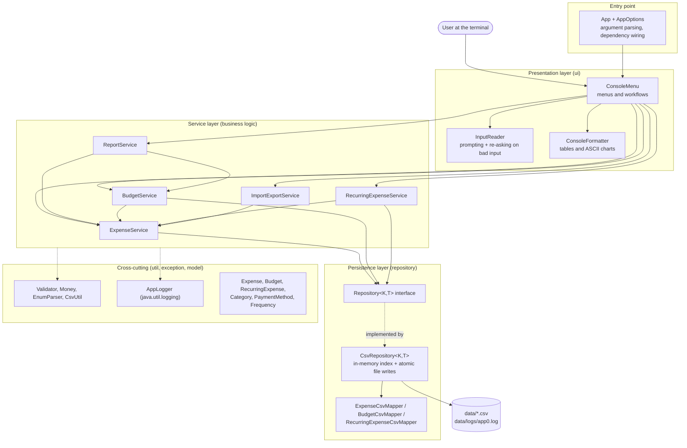
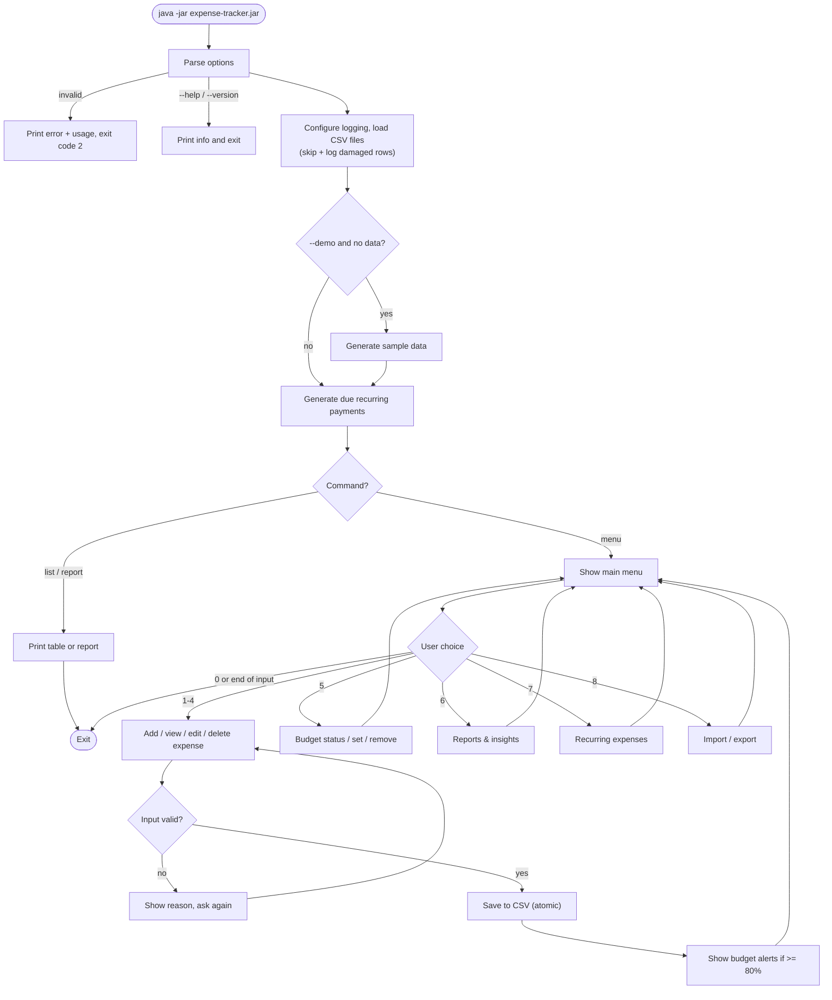
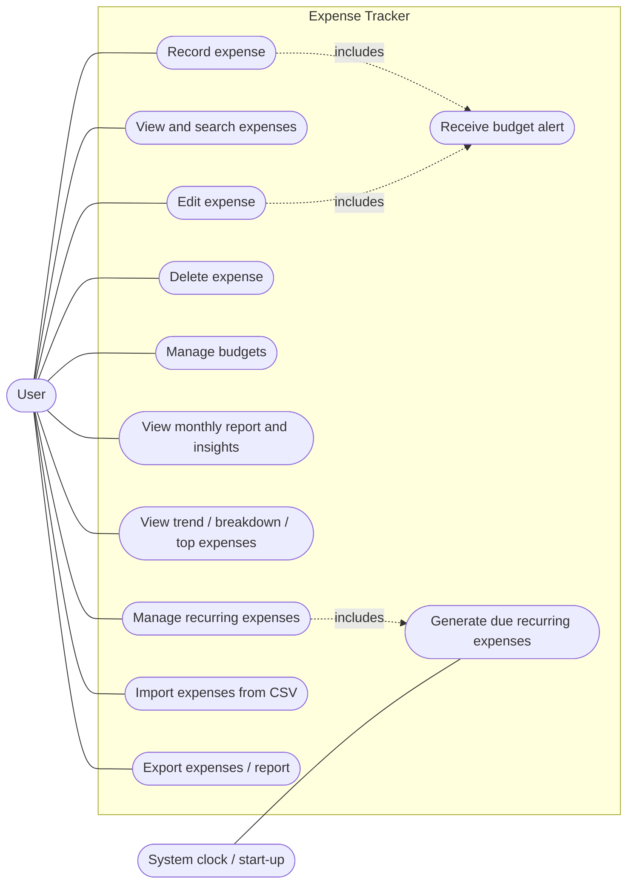
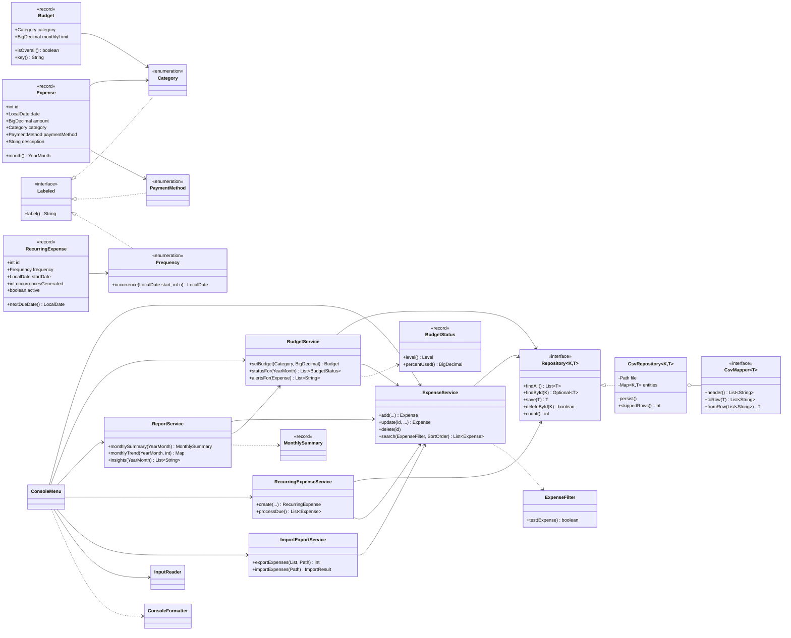
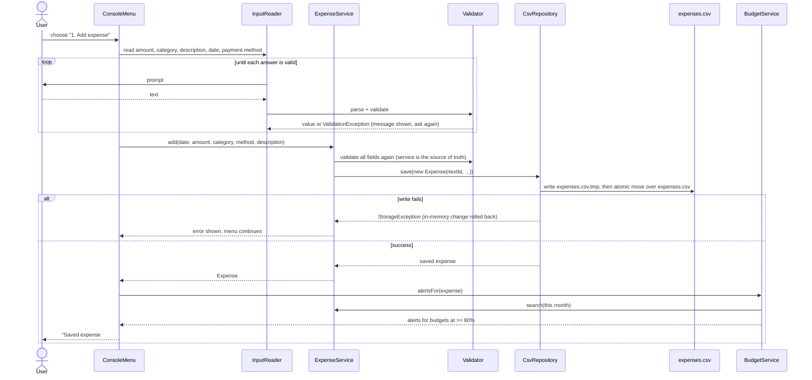
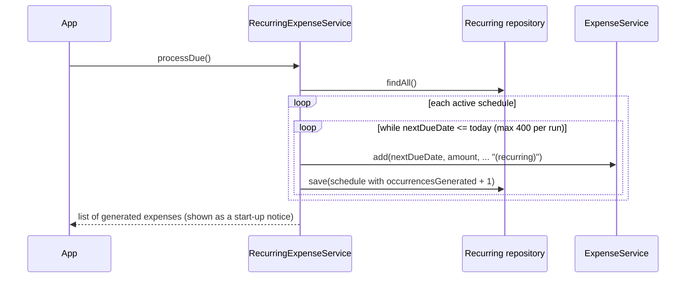
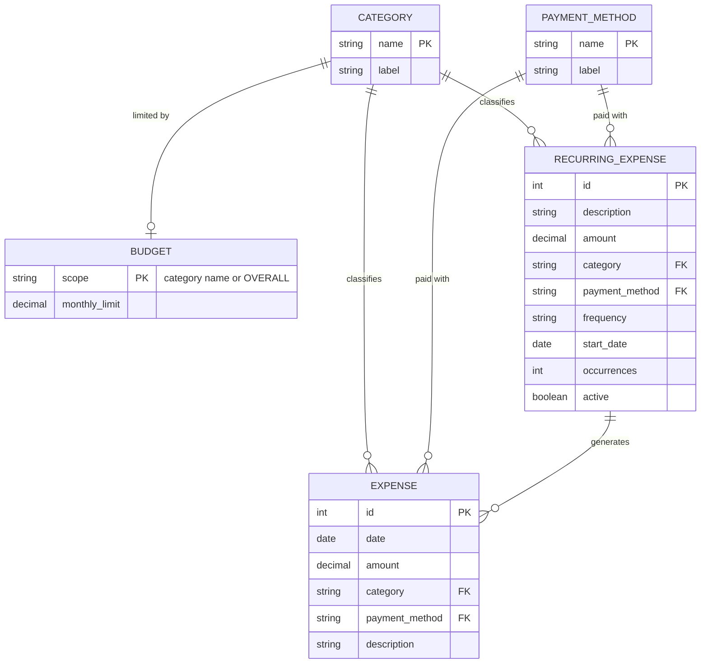

# Design Document: Expense Tracker

This document describes the architecture, the main design decisions and the UML diagrams of the
application. The diagrams are written in Mermaid, which GitHub renders directly in the browser.

## 1. System architecture

The application uses a **layered architecture**. Each layer only calls the layer below it, so
the console UI could be replaced (for example by a web UI) without changing business logic. The
CSV storage could likewise be replaced by a database without touching the services.

## 2. Process flow / workflow

## 3. Use case diagram

## 4. Class diagram

## 5. Sequence diagram: adding an expense

## 6. Sequence diagram: generating recurring expenses at start-up

## 7. Storage design

### ER diagram

The data is stored in three CSV files. Categories, payment methods and frequencies are Java
enums, stored by name. They are shown as entities to make the relationships clear.

### Schema

| File | Columns | Key | Rules |
|---|---|---|---|
| `expenses.csv` | `id,date,amount,category,payment_method,description` | `id` (auto-increment) | amount > 0 and ≤ 10,000,000 with at most 2 decimals; date between 2000-01-01 and today; description 1–100 chars without line breaks |
| `budgets.csv` | `scope,monthly_limit` | `scope` | scope is `OVERALL` or a category name; at most one budget per scope |
| `recurring.csv` | `id,description,amount,category,payment_method,frequency,start_date,occurrences,active` | `id` | next due date = `frequency.occurrence(start_date, occurrences)` |

## 8. Design decisions and rationale

| Decision | Rationale |
|---|---|
| **Layered architecture + generic `Repository<K,T>`** | Business rules don't depend on how data is stored. One generic `CsvRepository` serves all three entity types via a pluggable `CsvMapper` (**Strategy pattern**). |
| **CSV instead of a database** | Zero setup for the user or evaluator, human-readable, opens in Excel. The repository interface keeps a later move to SQLite/JDBC cheap. |
| **Load everything into memory, write through on every change** | Personal expense data is small (thousands of rows), so this gives O(1) lookups and simple code. Writing a temp file then doing an atomic move means a crash never corrupts data. |
| **Immutable records for entities** | `Expense`, `Budget`, `RecurringExpense`, `BudgetStatus` and `MonthlySummary` are records. They can't be modified by accident, and equality works out of the box (useful in tests). |
| **`BigDecimal` for money** | `double` cannot represent 0.10 exactly, and rounding errors add up in totals. |
| **Validation in the service layer** | The UI validates for instant feedback, but the service validates again, so imports and recurring generation obey exactly the same rules. |
| **Injected `Clock`** | "Today" controls future-date checks, projections and recurring generation. A fixed clock makes these deterministic in tests. |
| **Recurring schedules store an occurrence counter, not a "next date"** | Dates are computed from the start date (`start.plusMonths(n)`), so the 31st never drifts to the 28th, and re-running generation is idempotent. |
| **Projection separates scheduled from day-to-day spending** | Rent paid on the 1st would otherwise be extrapolated as if it happened daily, grossly over-estimating month-end spending. |
| **Unchecked exception hierarchy** | `ValidationException`, `NotFoundException` and `StorageException` share `ExpenseTrackerException`, so the menu handles all expected errors in one `catch`, and unexpected ones are logged without crashing. |
| **Own tiny test framework** | `@Test` annotation + reflection runner means tests run with nothing but a JDK: no Maven, no internet. It also demonstrates annotations and reflection. |
| **Composition root in `App`** | All objects are created and wired in one place (manual dependency injection), keeping classes decoupled and easy to construct in tests. |

### Design patterns used

- **Repository**: `Repository<K,T>`, `CsvRepository`
- **Strategy**: `CsvMapper<T>` implementations; `SortOrder` enum holds a `Comparator`
- **Specification / Predicate**: `ExpenseFilter implements Predicate<Expense>`, built fluently
- **Dependency injection**: constructor injection of repositories, services and `Clock`
- **Template-like formatting helpers**: `ConsoleFormatter` returns strings, reused for the screen and for files
